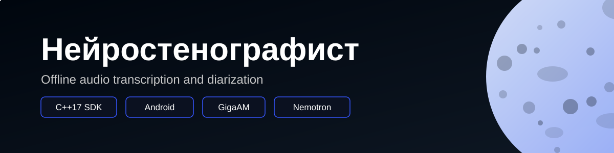

# Нейростенографист / Nuclear Audio SDK



Локальный офлайн-конвейер для транскрибации аудиодиалогов с диаризацией.

## Установка

Скачайте и установите готовый APK из [GitHub Releases](https://github.com/PytoByte/NuclearHack/releases/tag/v1.0.0).

## Презентация и демонстрация

- [Презентация решения (PDF)](artifacts/presentation.pdf)
- [Видео работы приложения](artifacts/demo.mp4)

## Использование

1. На главном экране выберите аудиофайл.
2. Дождитесь завершения транскрибации.
3. Результат доступен по нажатию на расшифровку в списке недавних или списке всех записей.
4. После открытия расшифровки можно скачать её в формате JSON по кнопке в правом верхнем углу.

## Сборка с моделями

На Linux x86_64 с установленными `uv` и `make`. Подготовка окружения
скачивает локальные JDK, Android SDK/NDK и зависимости.

```sh
make android-host-bootstrap
uv run python scripts/bootstrap_models.py \
  giga-v3-ctc-punct nemotron3-diarization-q8 \
  giga-v3-ctc pyannote-eres2net-fp32
make mobile-build
make android-app
```

Две последние модели нужны для совместимого fallback-пути клиента.
Модели проверяются по SHA при загрузке developer-инструментом; LLM-веса не нужны.
Результат: `.build/android-app/neurostenographer-debug.apk`.

## Дебаг-сборка

После подготовки native-библиотек и моделей:

```sh
export JAVA_HOME="$PWD/.tools/jdk" ANDROID_HOME="$PWD/.tools/android-sdk"
cd src/mobile/android
sh gradlew :app:assembleDebug -PrequireNativeAudio=true
```

Результат: `src/mobile/android/app/build/outputs/apk/debug/app-debug.apk`.

## Релиз-сборка

```sh
make android-release
```

Результат: `.build/android-app/neurostenographer-release-signed.apk`.

## Документация

- [Архитектура, модели и ограничения](docs/ARCHITECTURE.md)
