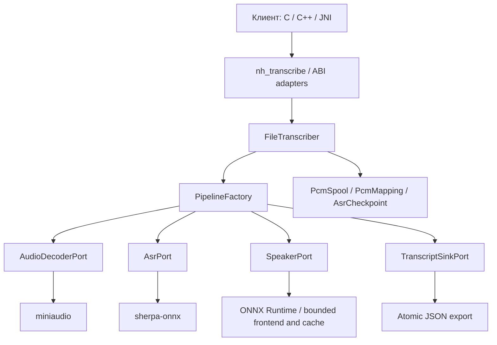

# Аудиомодуль: текущая архитектура

07.11.2026. Самостоятельный C++17 SDK с C ABI1. Выбранный публичный файловый
API — `nh_transcribe`. История A/B, метрики и решения — [RESEARCH.md](RESEARCH.md).

## Контракт и финальный состав

Клиент передаёт `nh_transcription_config`: локальные пути моделей/tokens,
scratch,output JSON,опциональные trace/checkpoint,threads и лимит длительности.
Один вызов выполняет весь путь. Отсутствуют зависимости inference от Python,
UI,JVM,сети и инструментов исследования. Модели доставляются заранее.

Preset `config/audio-sdk-preset.json` / `ru-offline-v1`:

```text
клиент → nh_transcribe → FileTranscriber
  decode MP3/WAV → mono16k f32 → unlinked disk PCM
  GigaAM-v3 CTC INT8 с собственной пунктуацией,20s chunks → release ASR
  read PCM blocks1s → Nemotron3 Diarization Q8 buffered → release speaker model
  first min(word duration,160ms) posterior mean → speaker per word
  merge adjacent same-speaker words,gap≤1200ms → strict transcript JSON
```

GigaAM остаётся ASR,а Nemotron — только diarizer. NeMo-Speech.cpp,WhisperX,
независимый aligner,RUPunct/Horizon и NME-SC не включены в runtime.
Пунктуация/case генерируются ASR; модельный текст не переписывается LLM.
Автоматическое число активных голосов,до8model slots; это не гарантия распознавания
всех8участников. ID канонизируются по первому слову и стабильны внутри файла.

Default0 в новой конфигурации означает4threads/600s. Доступный явный лимит1..600s.
Профиль buffered,chunk20s и anchor160ms фиксированы основным API.
Это обработка готового файла; low-latency speaker profile не выдаётся за готовый
real-time микрофонный ASR. Полный600s synthetic soak не является проверкой
качества естественного десятиминутного разговора.

## Слои и владение ресурсами



- `pipeline.cpp`: тонкие C ABI адаптеры,основной preset и совместимые entry points.
- `file_transcriber.*`: проверка запроса,стадии,отмена,последовательность ресурсов,экспорт.
- `pipeline_ports.hpp`: контракты декодера,ASR,спикеров,экспорта и фабрики.
- `pipeline_factory.cpp`: native adapters и выбор posterior/legacy speaker backend.
- `pipeline_storage.*`: noncopyable RAII для scratch PCM,mmap,locked ASR checkpoint;
  проверка alias путей и атомарная запись JSON.
- `mel.*`,`speaker_cache.*`,`posterior_merge.hpp`: DSP/state/накопление вероятностей.
  Внутренние DSP циклы не используют virtual dispatch.
- Низкоуровневые ASR/diar/VAD и optional summary остаются независимыми C API.

Фабрика не загружает модели заранее. ASR adapter существует только внутри
стадии распознавания и уничтожается перед созданием speaker adapter.
Runtime: sherpa-onnx2.0.1 / ONNX Runtime1.28.2 CPU,miniaudio0.11.23.
CMake/Ninja; Linux x86_64 и NDKr27d/API26 для Android ARM64/x86_64.
Release без fast-math; общие native библиотеки,статическая C++ runtime Android.
Версии/SHA — `config/*lock.json`,инструменты — `uv.lock`.

## PCM, таймлайн и память

miniaudio потоково декодирует с mono mixing и настоящим ресемплированием:
linear + low-pass8-го порядка. RIFF/RF64 WAVE header имеет приоритет над расширением.
Декодер переиспользует один блок; PCM spool — mkstemp + немедленный unlink.
На диске64KB/s; ASR читает ограниченные чанки,короткий хвост перераспределяется,
input<1s дополняется только для модели.

Новый speaker backend читает spool блоками16000samples. Frontend:
Slaney128mel,Hann400,FFT512,hop160,preemphasis.97. Cache264×512,
FIFO40×512; profile340/right40/update300. Logical PCM≤486641samples (~1.86MiB),
features≤3040×128float. Это границы собственных буферов,не общий RSS ORT.
Полная матрица posteriors не хранится:на слово8double sums,anchor≤16rows.
Слова/JSON/диагностические turns растут с длительностью,ограниченной API.

CTC word timestamps — token spans,last character+40ms,не forced alignment.
При невозможности exact reconstruction сохраняется whole-chunk span и
`chunk_fallback` в trace. Word timestamp MAE не измерен без manual GT.
Модель спикеров выдаёт10ms rows; EOF<10ms не образует полной строки.
Argmax назначает слот даже при слабой уверенности:zero unknown не доказывает качество.
Стерео сводится в mono; cross-file speaker identity и channel-aware diarization отсутствуют.

## Ошибки, отмена, checkpoints и JSON

Вызовы блокируют поток клиента. Handles явно уничтожаются после окончания
операций; callback buffers borrowed до возврата,исключения через C ABI запрещены.
Один high-level file/summary job на процесс; повторный вход — `NH_BUSY`.
Низкоуровневые отдельные handles независимы,их общий бюджет контролирует клиент.

Progress:queued/decode/checkpoint_identity/asr_load/asr/asr_cached/
speaker_stream_load/speaker_stream/merge/done. Отмена между decode blocks,
ASR chunks и speaker inference steps; синхронный NN call не прерывается посередине.
Speaker progress считает уже emitted source samples,а не read-ahead PCM.

ASR checkpointv2: SHA256 decoded PCM,модель/tokens,architecture/platform,
runtime,chunk/thread/padding policy; flock,atomic update,metadata≤64MiB.
Resume повторно декодирует вход,переиспользует завершённые ASR chunks;
при полном cache ASR вообще не загружается. Diarization пересчитывается.

Основной JSON содержит только `transcript` с
`speaker_id/start_ms/end_ms/text`; время — integer ms исходной timeline.
Trace отдельно сохраняет backend ASR,words,slots,source PCM hash,diagnostic turns,
profile/runtime/counters/NNtime. Output/trace защищены от alias входа/моделей,
включая external speaker weights `<model>_data`.
Экспорт temp/fsync/rename атомарен для каждого файла,trace публикуется первым;
двухфайловой транзакции нет. Ошибка/отмена до export сохраняет прежние файлы.

## Совместимость и дополнительные возможности

Старые ABI1 структуры/символы сохранены:их вызывают существующие клиенты и тесты.
`nh_transcribe_file*` — legacy pyannote segmentation FP32 + ERes2Net + auto AHC;
optional global refinement использует complete-link cosine и predicted-overlap
cannot-links. Непрерываемый whole-file legacy diarizer остаётся ограничением
latency отмены старого режима. Это не рекомендуемый новый preset.

Отдельно доступны CTC/RNNT/Whisper adapters,Silero VAD и stateful speaker API.
VAD не включён в файловый preset без подтверждённого A/B. Optional
`nh_summarize_file`: llama.cpp/Qwen3-0.6B,отдельный результат без изменения JSON;
контекст4096/output≤256,overflow возвращает ошибку. Qwen weights не входят в
минимальный transcription bundle. Сборки с llama поставляют его runtime libs.

## Android-клиент

`src/mobile/android` — Jetpack Compose/MVVM клиент. Gradle не компилирует
native SDK: задачи `syncNativeAudio` и `syncAudioAssets` берут готовые
`.build/android-<abi>/libnuclear_audio*.so`, `.tools/sherpa-android/<abi>/*.so`
и локальные `models/*`, затем упаковывают их в APK. `NativeAudio.java` —
app-specific JNI-мост к C ABI; `AudioEngine.kt` выполняет blocking-вызовы
в IO-диспетчере, `AudioModelStore.kt` один раз копирует assets в
`filesDir/models`, `TranscriptRepository.kt` импортирует SAF-аудио и хранит
строгий JSON, `MainViewModel.kt` управляет прогрессом, отменой и ошибками.
Финальный preset `giga-v3-ctc-punct` + `nemotron3-diarization` выбирается
при наличии; иначе работает legacy `giga-v3-ctc` + `diarization`.
Сводка Qwen показывается только при `nh_llm_available() == 1`. Манифест
не содержит `INTERNET`. `make android-app` проверяет libs/assets и собирает
APK; физический ARM-запуск и метрики устройства не измерены.

## Сборка, поставка и подтверждение

`src/audio/.clang-format` + pinned clang-format19.1.7; pre-commit проверяет staged
native blobs. Gates: `make check native-test native-sanitize leak-check mobile-build
native-format-check research-test`,Android ktlint/detekt/Lint.
ASan/UBSan покрывают наш код,а не предсобранный ORT/sherpa. Ctest-набор включает
`lifecycle-smoke`: полный create→process→destroy каждого handle на pinned моделях,
плюс VAD churn-циклы с проверкой роста VmRSS (RSS-гейт работает только в обычном
build, под ASan arenas он ложно срабатывает); `make leak-check`
(scripts/leak_check.py, ~3 мин) прогоняет параллельно cppcheck, clang-tidy
(clang-analyzer), ASan/LSan через ctest и Valgrind на обычном build — Valgrind по
умолчанию только VAD-путь (`--valgrind-all-models` для полного набора моделей),
логи — в `.audio-runs/leak-<stamp>/`. Результаты зафиксированы в RESEARCH.md (246–251).

`make sdk-package` создаёт `.build/nuclear-audio-sdk-ru-v1.tar`: public header,
C-пример,CLI/runtimes Linux x86_64 и Android ARM64/x86_64,только выбранные модели,
лицензии,SHA manifest,preset и build provenance. Research data/scripts/модели,
Python и тестовый APK в комплект не входят. Linux launcher задаёт local library
path; Android-клиент доставляет ABI libs/weights и вызывает C ABI через свой слой.

Проверки качества —6известных natural RU silver записей; независимого gold и
ручных word timestamps нет. Короткий третий голос,overlap и одна тяжёлая запись
остаются ограничениями. Физический ARM runtime/качество/RTF не измерены;
ARM cross-build и16KiB ELF alignment не заменяют запуск на устройстве.
Подробные метрики,paired before/after parity и resource tests — в RESEARCH.md.
